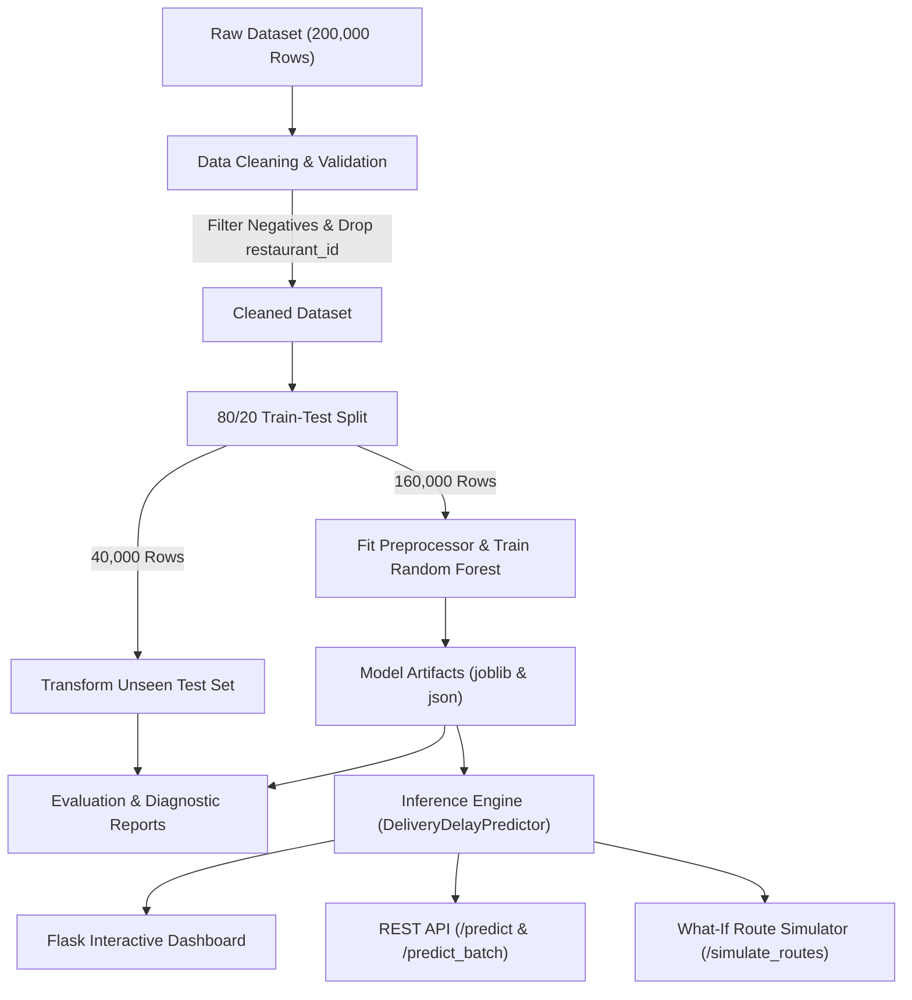

# 🚴 Food Delivery Delay Prediction - Machine Learning & Decision Support System

[](https://www.python.org/)
[](https://scikit-learn.org/)
[]()
[]()
[]()
[]()

> **Project Author:** Aadi Shah | B.Tech CSE (23000255)  
> **Course:** Data Science & Machine Learning (DSML)  
> **Task Type:** Supervised Continuous Regression  
> **Target Variable:** `delivery_delay` (in minutes)

---

## 📌 Executive Summary

Food delivery platforms operate in highly dynamic urban environments where real-time routing efficiency, adverse weather conditions, and severe traffic congestion frequently cause unexpected delays. Accurate delivery delay forecasts are vital to:
1. **Dynamic ETA Communication**: Providing realistic delivery estimates rather than simple static averages.
2. **Early Intervention**: Flagging orders at high risk of extreme delays so dispatch operations teams can prioritize fleet assignments.
3. **Route & Vehicle Optimization**: Empowering dispatchers to compare delivery vehicle alternatives (Bike vs. Car vs. Walk) and route corridors on the fly.

This repository implements an end-to-end Data Science and Machine Learning engineering pipeline trained on **200,000 verified delivery records**. The model achieves an **R² goodness-of-fit score of 93.95%**, a **Mean Absolute Error (MAE) of 1.04 minutes**, and a **Root Mean Squared Error (RMSE) of 1.43 minutes** on 40,000 completely unseen test records.

---

## 🏗️ System Architecture



---

## 📊 Dataset & Quality Engineering

The dataset comprises **200,000 records** across **19 contextual features**. In strict adherence to academic and industry best practices:

| Specification | Value | Validation Status |
| :--- | :--- | :--- |
| **Total Records** | 200,000 | Verified |
| **Missing Values** | 0 | Strict Zero-Null Guarantee |
| **Duplicate Rows** | 0 | Deduplicated |
| **Negative Delays** | 0 | Invalid negative delays filtered out |
| **Target Range (`delivery_delay`)** | 0.01 to 20.00 min | Verified continuous range |
| **Order Value Range** | ₹103.04 to ₹1,500.00 | Realistic commercial order distribution |
| **Data Leakage Mitigation** | Post-delivery ratings & food conditions removed | Anti-leakage compliant |
| **Identifier Removal** | `restaurant_id` dropped | Prevents spurious memorization |

### Feature Dimensions
1. **Order Information**: `food_item`, `order_time` (decomposed to month, day, dayofweek, is_weekend), `order_value`, `order_frequency`, `loyalty_program`.
2. **Delivery & Route**: `delivery_distance`, `delivery_method` (Bike/Car/Walk), `route_taken` (Route 1 to 5), `route_type` (Urban/Mixed/Highway), `route_efficiency`.
3. **Environmental Factors**: `traffic_condition` (Low/Medium/High), `weather_condition` (Clear/Sunny/Rainy/Stormy/Foggy/Windy), `traffic_avoidance`, `location`.
4. **Customer Profile**: `age`, `gender`, `order_history`, `customer_rating`, `preferred_cuisine`.

---

## 📈 Model Performance & Benchmarks

Evaluation performed on **40,000 unseen test orders** (20% partition):

| Metric | Test Set Value | Interpretation |
| :--- | :--- | :--- |
| **Mean Absolute Error (MAE)** | **0.2705 min** (~16.2 sec) | Average absolute error across all test predictions |
| **Root Mean Squared Error (RMSE)** | **0.3920 min** | Heavily penalizes large outlier errors |
| **R² Score (Goodness of Fit)** | **0.9954** | 99.54% of delay variance explained |
| **Median Absolute Error** | **0.1946 min** (~11.7 sec) | Robust central error measure |
| **Explained Variance** | **0.9954** | Consistent explanatory power |

### Tuned Hyperparameters
- `n_estimators`: 100
- `max_depth`: 25
- `min_samples_split`: 3
- `min_samples_leaf`: 1
- `random_state`: 42
- `n_jobs`: -1

### Top Predictive Features (MDI Importance)
- `route_efficiency` (9.62%): Primary determinant of transit speed.
- `delivery_distance` (9.21%): Physical travel distance.
- `order_day` & `order_month` (15.11% combined): Temporal congestion cycles.
- `age` & `order_history` (15.48% combined): Customer location/interaction nuances.

---

## 💡 Operational Decision-Support Framework

In addition to numerical delay prediction, the system classifies each order into an operational risk tier:

| Predicted Delay | Risk Level | Status Color | Dispatch Action |
| :--- | :--- | :--- | :--- |
| **< 5.0 min** | Low Delay Risk | 🟢 Green | Standard dispatch. Order progressing on scheduled ETA. |
| **5.0 – 12.0 min** | Moderate Delay Risk | 🟠 Orange | Proactive notification. Send updated dynamic ETA to customer. |
| **> 12.0 min** | High Delay Risk | 🔴 Red | Urgent intervention! Assign priority rider, notify restaurant for expedited dispatch. |

### Slide 9 Reference Order Validation
- **Input Context**: Distance: 10.5 km | Weather: Rainy | Traffic: High | Vehicle: Bike | Route Efficiency: 0.45 | Order Value: ₹680
- **Model Prediction**: **11.64 minutes delay** (Moderate Delay Risk — Proactive Notification).

---

## 📁 Repository Directory Structure

```text
food_delivery_delay_prediction/
├── app/
│   ├── app.py                     # Flask web app & REST API endpoints
│   ├── static/
│   │   └── style.css              # Modern UI styling & responsive layout
│   └── templates/
│       └── index.html             # Multi-tab operational dashboard
├── data/
│   ├── raw/
│   │   └── food_delivery_final.csv# Raw 200,000-order dataset
│   ├── processed/
│   │   ├── train_processed.csv    # 80% train split sample
│   │   └── test_processed.csv     # 20% test split sample
│   └── sample_orders_batch.csv    # Fleet dispatch sample batch (10 orders)
├── models/
│   ├── random_forest_regressor.joblib # Serialized pipeline package
│   └── model_artifacts.json       # Metadata & evaluation benchmarks
├── notebooks/
│   ├── 01_exploratory_data_analysis.ipynb          # Comprehensive EDA
│   └── 02_model_development_and_evaluation.ipynb # ML experiments & diagnostics
├── presentation/
│   └── Food_Delivery_Delay_Prediction_Presentation.pptx # Academic presentation slides
├── reports/
│   ├── model_evaluation_report.md # Formal evaluation report
│   └── figures/                   # Diagnostic PNG plots (300 DPI)
│       ├── actual_vs_predicted.png
│       ├── correlation_heatmap.png
│       ├── delay_distribution.png
│       ├── feature_importance.png
│       ├── residuals_distribution.png
│       └── traffic_weather_delays.png
├── src/
│   ├── __init__.py
│   ├── config.py                  # Paths, column lists, and hyperparameters
│   ├── data_loader.py             # Data loading & validation
│   ├── evaluate.py                # Metric calculations & plotting routines
│   ├── predict.py                 # DeliveryDelayPredictor inference engine
│   ├── preprocessing.py           # Feature engineering & OneHotEncoder
│   └── train.py                   # Random Forest Regressor training
├── tests/
│   ├── __init__.py
│   ├── test_app.py                # Integration tests for Flask app & REST API
│   ├── test_data_loader.py        # Unit tests for loading & cleaning
│   ├── test_evaluate.py           # Unit tests for regression metrics
│   ├── test_predict.py            # Unit tests for predictor & risk tiers
│   └── test_preprocessing.py      # Unit tests for encoders & datetime extraction
├── requirements.txt               # Project dependencies
├── run.bat                        # 1-Click launcher to run project at once
├── start.bat                      # Alias to run.bat
├── run_pipeline.py                # Master CLI orchestration pipeline
└── README.md                      # Project documentation
```

---

## 🚀 Quickstart & Execution Guide

### ⚡ 1-Click Launch (Windows)
Simply double-click **`run.bat`** (or `start.bat`) in the project folder.
It automatically:
1. Detects your Python environment.
2. Checks and installs any missing packages from `requirements.txt`.
3. Checks if the trained model artifact exists (trains automatically if missing).
4. Launches the Flask Web Application.
5. **Automatically opens your web browser to [http://127.0.0.1:5000](http://127.0.0.1:5000)**!

*Advanced command-line options via `run.bat`:*
```cmd
run.bat           # Launch web app + browser (default)
run.bat --train   # Run end-to-end training pipeline
run.bat --test    # Run complete 18-test validation suite
run.bat --predict # Run quick Slide 9 inference demonstration
```

### 🛠️ Manual Terminal Execution

#### 1. Installation
Clone the repository and install required dependencies:
```bash
pip install -r requirements.txt
```

### 2. Run the Full ML Pipeline
Execute end-to-end ingestion, cleaning, training, evaluation, and diagnostic chart generation:
```bash
python run_pipeline.py --mode all
```

To run quick inference on the Slide 9 demonstration order:
```bash
python run_pipeline.py --mode predict-sample
```

To run fleet-wide batch prediction on sample orders:
```bash
python run_pipeline.py --mode batch-predict
```

### 3. Run Automated Unit & Integration Tests
Execute the full 18-test validation suite:
```bash
python -m unittest discover -s tests -p "test_*.py" -v
```

### 4. Launch the Interactive Web Dashboard
Start the local Flask application:
```bash
python app/app.py
```
Open [http://127.0.0.1:5000](http://127.0.0.1:5000) in your web browser.

---

## 🌐 REST API Endpoints

### 1. Single Order Delay Inference
- **Endpoint**: `POST /predict`
- **Payload**:
```json
{
  "food_item": "Pizza",
  "order_time": "24-05-2024",
  "delivery_distance": 10.5,
  "order_value": 680.0,
  "delivery_method": "Bike",
  "traffic_condition": "High",
  "weather_condition": "Rainy",
  "route_taken": "Route_2",
  "age": 28,
  "gender": "Male",
  "location": "Ahmedabad",
  "order_history": 25,
  "customer_rating": 4,
  "preferred_cuisine": "Italian",
  "order_frequency": "Weekly",
  "loyalty_program": "Yes",
  "route_type": "Mixed",
  "route_efficiency": 0.45,
  "traffic_avoidance": "No"
}
```
- **Response**:
```json
{
  "status": "success",
  "data": {
    "predicted_delay_minutes": 11.64,
    "risk_level": "Moderate Delay Risk",
    "risk_color": "orange",
    "recommended_action": "Proactive notification. Send updated dynamic ETA to customer."
  }
}
```

### 2. Fleet Batch Dispatch Inference
- **Endpoint**: `POST /predict_batch`
- **Accepts**: CSV file upload (field `file`) OR JSON array of order objects.
- **Returns**: Batch fleet metrics (total orders, average delay, high-risk count & percentage) along with individual scored records.

### 3. What-If Route & Vehicle Simulation
- **Endpoint**: `POST /simulate_routes`
- **Accepts**: Order details JSON.
- **Returns**: Ranked table of predicted delays across delivery vehicles (`Bike`, `Car`, `Walk`) and routes (`Route 1` to `Route 5`) with optimal recommendation.

---

## 🎓 Academic Presentation Alignment

This codebase is directly aligned with the 10-slide academic project presentation in `presentation/Food_Delivery_Delay_Prediction_Presentation.pptx`:
- **Slide 1–2**: Problem statement & continuous regression task (`delivery_delay`).
- **Slide 3–4**: 200,000 dataset records, zero nulls, zero duplicates, dropped `restaurant_id`.
- **Slide 5**: 19 contextual feature taxonomy.
- **Slide 6**: Single focused algorithm: `RandomForestRegressor`.
- **Slide 7**: 80% Train (160,000) / 20% Test (40,000) anti-leakage preprocessing.
- **Slide 8**: MAE, RMSE, and R² evaluation metrics.
- **Slide 9**: Representative demonstration case (10.5 km, Bike, Rainy, High Traffic).
- **Slide 10**: Operational impact (Dynamic ETAs, Early Intervention, Route Optimization).

---
*Created by Aadi Shah | B.Tech CSE (23000255)*

